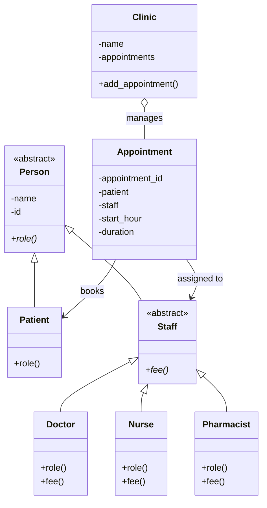

# Clinic Appointment Management System

## 1. Project Description

This project is a Clinic Appointment Management System developed using Python.

It represents patients, clinic staff and appointments using Object-Oriented Programming principles.

## 2. Class Diagram

## 3. Question 2 – Encapsulation and Invariants

### Encapsulation

- Class attributes are private using Python name mangling.
- Read-only properties provide controlled access to object data.
- The Clinic returns an immutable tuple of appointments instead of exposing its internal list.

### Validation

- Empty names are rejected.
- Non-positive IDs are rejected.
- Appointment IDs must be positive integers.
- Appointments must have valid Patient and Staff objects.
- Appointment start hours must be between 0 and 168.

### Appointment Status Management

Appointments support three statuses:

- PENDING
- CONFIRMED
- CANCELLED

The system enforces the following rules:

- Only pending appointments can be confirmed.
- Cancelled appointments cannot be reactivated.
- Appointments cannot be cancelled after they have started.
- Confirmed appointments cannot be cancelled less than two hours before their start time.

### Clinic Invariants

- The clinic must have a non-empty name.
- Only valid Appointment objects can be added.
- Appointment IDs must be unique within the clinic.
- The internal appointments collection is protected.

### Testing

Tests are located in the `tests/` directory and cover validation, encapsulation, appointment status transitions and Clinic invariants.
