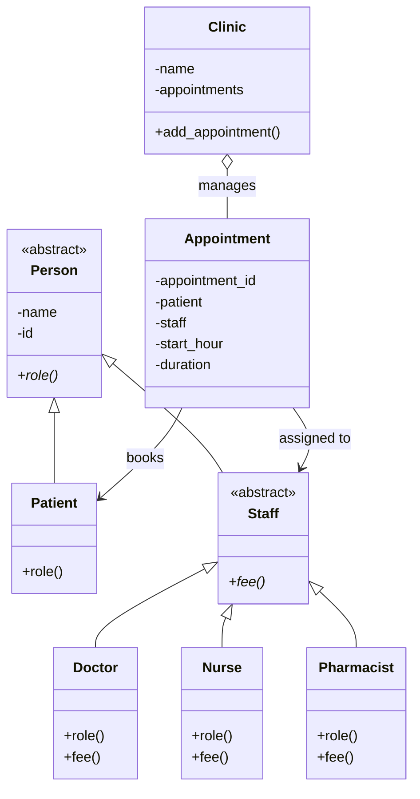

# Clinic Appointment Management System

## 1. Project Description

This project is a Clinic Appointment Management System developed using Python.

It represents patients, clinic staff and appointments using Object-Oriented Programming principles.

## 2. Class Diagram

