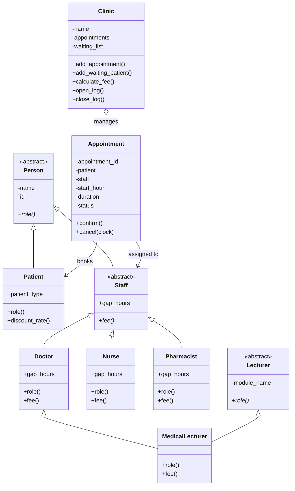

<<<<<<< HEAD
# Clinic Appointment Management System

## 1. Project Description

This project is a clinic appointment system built in Python. It models patients, staff, appointments and clinic operations using object-oriented programming. The main aim was to keep the code simple while still following the rules and constraints in the assignment.

I used encapsulation, validation and inheritance to keep the system under control. Each class has its own responsibility and the clinic is responsible for checking the rules between appointments and staff.

## 2. Class Diagram

## 3. Question 2 – Encapsulation and Invariants

I made sure the important data was hidden and only accessed through controlled methods and properties. This is the main part of the encapsulation requirement.

For example:

- names and IDs are private inside the person classes
- appointments keep their own private data
- the clinic keeps its appointments list private
- the clinic returns a tuple instead of exposing the original list

I also added checks so invalid data is rejected early. Empty names, invalid IDs, invalid appointment objects and bad time values all raise errors instead of being allowed into the system.

The appointment system also follows strict rules:

- only pending appointments can be confirmed
- cancelled appointments cannot be used again
- an appointment cannot be cancelled once it has started
- a confirmed appointment cannot be cancelled less than two hours before its start time

The clinic also keeps its own invariants such as unique appointment IDs and valid appointment objects only.

---

## 4. Question 4 – Clinic Logging and Safe Lifecycle

This part was about making the clinic behave in a safe and traceable way. The clinic needs to keep a record of what is happening and log when an action fails.

I used Python's logging module so the clinic can record important actions. The class logs events like opening and closing, as well as failed operations such as invalid appointment entries or duplicate IDs. This makes it easier to see what happened and helps with debugging.

This matches the assignment because the clinic is not only storing data; it is also managing operations in a controlled way. The validation rules from the earlier questions are still used, and the logging simply adds an extra layer of safety.

---

## 5. Question 5 – Lecturer and MedicalLecturer

The next part was about adding a lecturer concept without breaking the earlier design. I created a separate `Lecturer` class that stores a module name, and then created `MedicalLecturer` as a class that is both a doctor and a lecturer.

This was done carefully so that the object still fits the original hierarchy. The `MedicalLecturer` is still a doctor for the clinic, but it also has teaching-related behaviour. The `role()` method still returns `Doctor`, which keeps the medical role consistent.

This is a good fit for the project because it extends the same object model instead of creating a completely separate system.

---

## 6. Question 6 – Rules Between Objects and the Twist

This part adds the more complex business rules. The important idea is that the rules are not only about one class; they involve different objects working together.

Some of the rules I implemented were:

- a patient cannot have two appointments at the same hour
- a staff member must have enough gap time between bookings
- waiting list behaviour is handled by the clinic
- some patient types get a discount in the fee calculation
- failed rules are logged so the issue is not hidden

The `P` in the formula means the patient number or patient ID. In the fee formulas, it is used with modulo arithmetic, so the value of `P` decides the result in a predictable way. For example:

- Doctor fee = 40 + 5 × (P mod 5)
- Nurse fee = 10 + (P mod 3)
- Pharmacist fee = 15

This means the patient number is used to vary the fee or business rule according to the patient’s ID.

---

## Design Decision Log

### D1. Where does the 2-hour rule live?
I kept the cancellation rule inside the `Appointment` class because it belongs to the appointment itself. The clinic only checks whether the appointment is valid before it is accepted.

### D2. Why is the clock design stable?
The clock is passed in as an object with a `now()` method. This makes it easier to test the code and keeps the logic separate from the system clock.

### D3. What changed when I added Pharmacist?
Not much in the appointment logic itself. The real change was extending the `Staff` hierarchy and keeping the `fee()` method consistent, so appointments can still work with any staff type without special-case checks.

### D4. What should happen if `MedicalLecturer.fee()` returns, and why does `Person` not get created twice?
`MedicalLecturer` should still use the doctor fee logic, because in this system it is still treated as a doctor. The reason `Person` is not created twice is because it is the parent class of the hierarchy, and the subclass only adds more behaviour.

### D5. What should happen if writing or closing the log itself fails?
That kind of failure should not be ignored. It should be raised or treated as an error, otherwise the system may continue without tracking real problems.

### D6. For the twist:

- the waiting list belongs to the clinic because it is a clinic-wide process
- a confirmed appointment cannot be bumped because it has already been accepted
- the gap rule is based on operational spacing, not on type checking
- the discount logic lives with the patient and clinic logic because it depends on the patient category and the final fee calculation

---

## Final Summary

This project brings together several object-oriented ideas: encapsulation, validation, inheritance, polymorphism and business rules between objects. The system is not only storing appointments; it is also enforcing rules so that the clinic behaves like a realistic appointment manager.

The project stays consistent with the first three questions because all later additions build on the same design instead of replacing it. That is why the model remains clean and easy to follow.
=======
# clinic-appointment-system
Clinic Appointment Management System
>>>>>>> 50da73b35489dca93b8b5eb2f51bf2b0c9e1d46b
