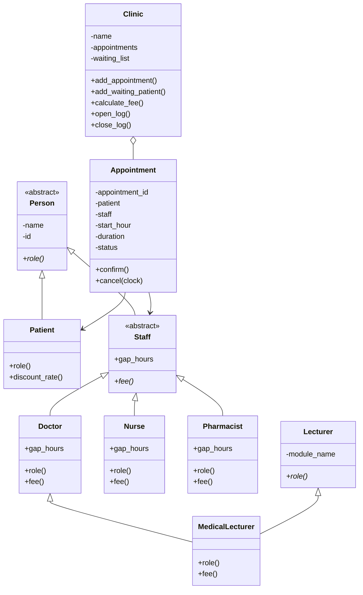

# Clinic Appointment Management System

## Group Members

Rutendo Sengera R2420416
Fadzayi B Nyaguse R2420429

# Clinic Appointment Management System

## 1. Project Description

This project is a clinic appointment management system developed in Python using object-oriented programming principles. It manages patients, medical staff, appointments and clinic operations while enforcing the rules specified in the assignment.

The system uses encapsulation, abstraction, inheritance, polymorphism and validation to maintain data integrity and ensure that appointments follow the required business rules.

## 2. Class Diagram



## 3. Question 2 – Encapsulation and Invariants

Encapsulation was used to protect important data and ensure that it can only be accessed or modified through controlled methods and properties.

Examples include:

- Names and IDs are stored as private attributes.
- Appointments protect their internal data.
- The Clinic keeps its appointments collection private.
- The Clinic returns a tuple instead of exposing its original appointments list.

Validation was also implemented to reject invalid data. Empty names, invalid IDs, invalid appointment objects and invalid time values raise errors.

The appointment system enforces the following rules:

- Only pending appointments can be confirmed.
- Cancelled appointments cannot be changed.
- Appointments cannot be cancelled after they have started.
- Confirmed appointments cannot be cancelled less than two hours before their start time.

The Clinic also enforces invariants such as unique appointment IDs and valid appointment objects.

## 4. Question 3 – Staff Fees and Polymorphism

### Fee calculations

Staff fees are calculated using the patient's ID, represented by P.

- **Doctor:** `40 + 5 * (P % 5)`
- **Nurse:** `10 + (P % 3)`
- **Pharmacist:** `5`

### Polymorphism

The abstract `fee(patient_id)` method is defined in the Staff class. Doctor, Nurse and Pharmacist provide their own implementations.

A single loop can work with different Staff objects by calling their `role()` and `fee()` methods without using type checks or type tags.

```python
for staff in staff_members:
    print(f"Role: {staff.role()}")
    print(f"Fee: ${staff.fee(patient.person_id)}")
```

### Extensibility

A new Staff subclass can implement the required methods without changing the existing polymorphic fee loop.

### Testing

Four unit tests cover the staff fee calculations and the effect of different patient IDs.

## 5. Question 4 – Clinic Logging and Safe Lifecycle

Python's logging module is used to record important clinic activities.

The Clinic records successful operations and failed actions, including invalid appointment entries and duplicate appointment IDs.

Logging provides a trace of system activity and makes it easier to identify errors during operation and testing.

The Clinic also manages its logging lifecycle through its opening and closing operations.

## 6. Question 5 – Lecturer and MedicalLecturer

A separate Lecturer class was introduced to represent teaching-related behaviour and store a module name.

MedicalLecturer inherits from both Doctor and Lecturer. This allows it to retain the medical staff behaviour while also having lecturer-related behaviour.

The `MedicalLecturer.role()` method returns:

`Doctor and Lecturer`

MedicalLecturer uses the Doctor fee calculation.

The Person constructor should execute only once when creating a MedicalLecturer object. Lecturer does not inherit from Person, preventing a second Person inheritance path.

## 7. Question 6 – Rules Between Objects and the Twist

The Clinic coordinates rules that involve multiple objects.

These include:

- Preventing a patient from having conflicting appointments.
- Enforcing staff booking gaps.
- Managing the waiting list through the Clinic.
- Applying patient discounts during fee calculation.
- Logging failed operations.

The staff object's `gap_hours` property provides the required booking buffer without checking the staff's concrete class type.

The patient's `discount_rate()` method provides the discount information used in fee calculation.

The Clinic coordinates these rules because they involve the relationship between patients, staff and appointments.

## 8. Design Decision Log

### D1. Where does the two-hour rule live?

The two-hour cancellation rule belongs in the Appointment class because it controls appointment status transitions. Placing it in the Clinic would mix appointment-specific rules with clinic management responsibilities.

### D2. Why is the Clock design testable?

The system uses an injected Clock object with a `now()` method instead of directly reading the computer's system time. This allows tests to control time and simulate different cancellation scenarios.

### D3. What changed when Pharmacist was added?

Pharmacist was added as a subclass of Staff and implements its own `role()` and `fee()` methods. The existing polymorphic fee loop does not need to be modified. This demonstrates extensibility.

### D4. How does MedicalLecturer calculate fees, and why is Person not created twice?

MedicalLecturer uses the Doctor fee calculation. For patient ID 77:

`40 + 5 * (77 % 5) = 50`

Python multiple inheritance allows MedicalLecturer to inherit from Doctor and Lecturer. Since Lecturer does not inherit from Person, there is only one Person inheritance path and the Person constructor is called once.

### D5. What happens if writing to or closing the log fails?

Logging failures should be treated as errors rather than silently ignored. The application should preserve the original operation error where possible and ensure resources are closed safely.

### D6. What are the design decisions for the twist?

- The Clinic owns the waiting list because it manages appointments and available slots.
- Confirmed appointments cannot be bumped because they have already been accepted.
- Staff buffer hours are obtained through the staff object's `gap_hours` property rather than type checks.
- Patient discounts are determined through the patient's `discount_rate()` method.

## 9. Final Summary

The Clinic Appointment Management System demonstrates object-oriented programming concepts including abstraction, encapsulation, inheritance, polymorphism and validation.

It also applies business rules to appointment management, staff scheduling, fee calculations and clinic logging.

The implementation builds on the original class structure while allowing additional staff types and clinic rules to be introduced without unnecessary changes to existing functionality.
